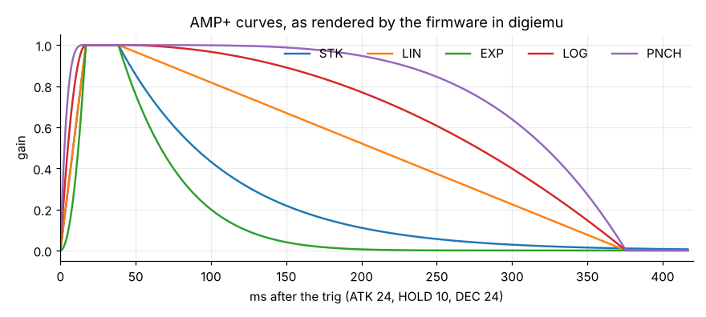
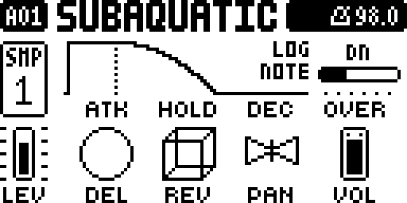
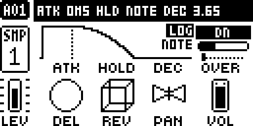

# AMP+ for the Digitakt mk1 (OS 1.54): v0.2

Envelope curves and a tempo-synced hold on the AMP page, per track. The idea comes from the Analog Rytm's
reworked AMP page (Modwerk's "Improved AMP"). No Digitakt mk1 version existed on the elekloader Mod Shop or
Modwerk (checked Nov 2026).

## Using it

On the AMP page:

- **FUNC + A** picks the active track's **curve**. Each detent is one step, and the screen redraws on
  the turn.
- **FUNC + B** sets the **hold**: turn right for **SYNC**, left for **FREE** (the stock hold).
- **While FUNC is held**:
  - the envelope picture shows the **real shape** of the curve you're on, with its name inverted;
  - under the name is the hold's mode: FREE, the note value or NOTE;
  - the title bar shows the times, e.g. `ATK 0MS HLD 1/4 DEC 3.6S`. In SYNC, HLD is the hold's length
    at the current tempo.
- A and B keep their values while FUNC is held. Turned on their own, they work as stock.
- A track on a curve or a synced hold keeps that picture after you let go of FUNC (the name not
  inverted, plus the note value in SYNC). A track on STK with a free hold shows the stock picture.

 

| curve | attack | decay | for |
|---|---|---|---|
| **STK** (default) | linear | exponential: the stock | as it was |
| **LIN** | linear | linear, to silence | tight, even fades that end cleanly |
| **EXP** | slow start (p²) | drops at once, (1−p)⁸: much steeper than stock | snappy hats, clicks, plucks |
| **LOG** | quick and rounded | stays up, then falls (1−p²) | round, full notes and pads |
| **PNCH** | fastest | full body, then a quick fall (1−p⁴) | punchy, gated kicks and the "chug" |

**Times stay the stock's.** Every attack lasts as long as the stock attack at that ATK. Every shaped
decay reaches silence exactly where the stock decay is 40 dB down, so a knob position means the same
length on every curve. DEC 127 still never decays.

**SYNC hold:** HOLD picks one of sixteen note values: 1/64, 1/32T, 1/32, 1/16T, 1/32., 1/16, 1/8T,
1/16., 1/8, 1/4T, 1/8., 1/4, 1/2T, 1/4., 1/2 and 1 bar. They follow the tempo live. HOLD 127 stays
**NOTE** (hold until the trig ends) in both modes.

**Smooth modulation.** Shaped curves and SYNC read ATK, HOLD and DEC at full 8.8 resolution, so an LFO
or a slide on them moves the time smoothly instead of in 128 steps.

**Changing a curve while a note plays is click-free.** The new curve picks up at the level the old one
had reached.

`docs/amp_curves.wav`: the five curves in order (the gains measured from the firmware in digiemu, ATK 24,
HOLD 10, DEC 24) on a 55 Hz saw with a click.

**Not saved yet:** like DN OVERDRIVE's types, the settings live in RAM. Every track starts on STK and
FREE at power-on, and they don't change with kits or patterns.

**0.2 changes:**
- You now pick while seeing the curve's shape; 0.1 showed a text panel instead.
- The times moved to the title bar, so nothing crowds the knob labels.
- Every detent is one step: 0.1 needed two, and threw away detents from quick turns.
- The screen redraws on the turn.

The sound engine is the same as 0.1.

## How it works

The stock envelope (0x400716c0) is reassembled byte for byte in `amp.s` (`stock_env.inc`, made by
`mk_stock.py`; all 157 instructions match). One thing is added: at the head of its per-track loop, a
track on a curve or a synced hold branches to `amp_track` in `env.c`. Every other track runs the stock
instructions, so **STK + FREE is the stock envelope, sample for sample**.

The state stays the stock's (0x4199ed64: the phase, and the level as negated Q31), so core's
`fw_amp_level` and BYTE's sleep still read it correctly. Shaped stages are drawn as straight pieces
between the curve's points at most 32 samples (0.67 ms) apart. The tempo comes from 0x4020df10
(BPM × 120).

## CPU

Cycles per audio block for the envelope with **all 8 tracks** on one setting (digiemu's ColdFire cycle
model, zero-wait memory). The test is a trig on every track, then 300 blocks through attack, hold and
decay.

| stock | STK + FREE | LIN | EXP | LOG | PNCH | STK + SYNC | PNCH + SYNC |
|---|---|---|---|---|---|---|---|
| 2,530 | 2,581 | 4,923 | 5,165 | 4,929 | 5,018 | 4,306 | 4,565 |

That's about **+300 cycles a block per shaped track**, and +50 a block in all for the check on stock
tracks. With all eight tracks shaped it adds roughly 1.5% of the CPU. Only tracks you change cost
anything; DN OVERDRIVE's heavier types cost more than this.

## Install

Flash one of (from `build/`):

- `build/Digitakt_OS1.54_amp0.2_digihealth1.2.syx`: core 4.4 + digihealth 1.2 + AMP+.
- `build/Digitakt_OS1.54_amp0.2_dnod0.6_digihealth1.2.syx`: the same plus DN OVERDRIVE 0.6. Both use the
  AMP page side by side: FUNC + A/B for AMP+, FUNC + D for the drive.

The OS shows AMP2. Or add `elemods/amp-dt-0.2-os1.54.elemod` to your own build (needs core 4.1+). It
hooks 0x400716c0, the first routine in digihealth's FAST AUDIO block. The copy carries the hook, and
`elekloader.lint` passes with core + digihealth + dnod.

## Tested

The tests run in digiemu on the real build, with the mod laid over the resumed OS 1.54 snapshot.

- `tests/test_env.py` + `tests/check_env.py`: all eight tracks are fed a constant level, so output over
  input is the envelope. Each track had its own setting (STK, LIN, EXP, LOG, PNCH, STK + SYNC 1/64,
  LIN + SYNC 1/32, PNCH with a NOTE hold ended by the trig's end). Results:
  - Every shaped gain follows a float model of its curve within 0.23% (from the 0.67 ms pieces).
  - Track 1 on STK + FREE **equals the stock firmware sample for sample** (22,752 samples).
  - Changing curves mid-attack and mid-decay never steps more than the envelope does on its own.
- `tests/test_ui.py`: the whole UI on the DN OVERDRIVE build. Checked:
  - FUNC + A steps the curve as described, and FUNC + B goes to SYNC.
  - A and B keep their values under FUNC; B on its own still turns HOLD.
  - FUNC + D still picks DN OVERDRIVE's type.
  - Going back to STK + FREE returns the track to the stock code.
  - FUNC + A on the FLTR page does nothing.
  - No fault.
- `tests/cycles.py`: the table above.
- **Not yet run on the unit.**
